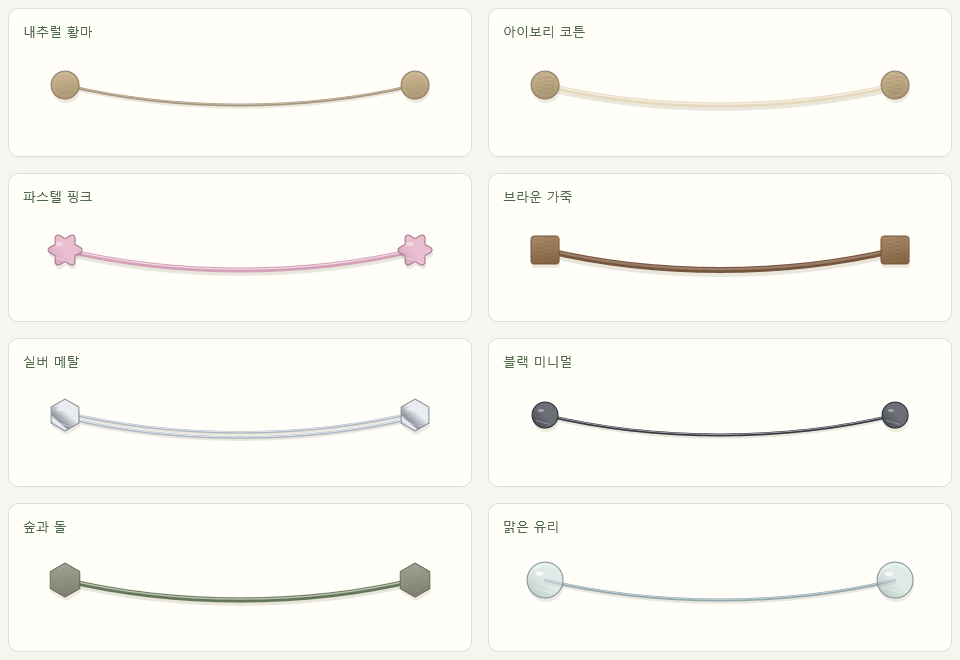

# Photo String · 나의 작은 사진 줄

끈과 집게에 사진을 걸어 Windows 바탕화면을 꾸미는 개인용 프로그램입니다. 다른 프로그램을 열면 사진 장식은 그 뒤에 가려집니다. 사진 교체·이동·레이어, 메모와 컬러 이모티콘, 끈과 좌우 노브 꾸미기를 지원합니다.

Windows 10/11 x64와 .NET Framework 4.8 이상이 필요합니다. 별도 설치나 인터넷 연결 없이 실행합니다.

## 실행과 사용

배포 파일 `PhotoString-Windows.zip`의 압축을 풀고 `PhotoString.exe`를 더블클릭하세요. 설정 화면에서 배치를 정하고 **적용 후 실행**을 누르면 바탕화면에 표시됩니다. `Ctrl+Alt+P`로 설정 화면을 다시 열 수 있습니다.

자세한 조작 방법과 이미지 가져오기는 [사용 안내](docs/USER_GUIDE.md)를 참고하세요.



사진·배치·개인 디자인은 실행 파일 옆의 `data/`에 자동 저장됩니다. 기존 사용 환경을 옮길 때는 실행 파일과 `data/`를 함께 옮기세요.

## 소스에서 빌드

Windows PowerShell에서 다음 명령을 실행합니다. Windows에 포함된 .NET Framework C# 컴파일러를 사용하며 추가 패키지는 필요하지 않습니다.

```powershell
powershell -NoProfile -ExecutionPolicy Bypass -File .\build.ps1
```

결과는 `dist/PhotoString.exe`입니다. `PhotoString.csproj`를 Visual Studio에서 열 수도 있습니다. 실행 정책 변경은 해당 PowerShell 프로세스에만 적용됩니다.

## 공유용 파일 만들기

```powershell
powershell -NoProfile -ExecutionPolicy Bypass -File .\package.ps1
```

소스를 새로 빌드하고 자체 검사를 통과한 실행 파일을 패키징합니다. 현재 사용하는 `dist/PhotoString.exe`와 `dist/data/`는 유지합니다. 공유 파일에는 아래에 명시한 소스와 실행 파일·사용 안내만 복사합니다.

| 위치 | 용도 |
| --- | --- |
| `share/github/` | GitHub 저장소에 올릴 소스·문서·빌드 스크립트 |
| `share/PhotoString-Source.zip` | 같은 소스를 묶은 ZIP |
| `share/windows-x64/` | 실행 파일과 사용 안내만 담은 사용자용 폴더 |
| `share/PhotoString-Windows.zip` | GitHub Releases에 첨부할 사용자용 ZIP |
| `share/SHA256SUMS.txt` | ZIP과 실행 파일의 SHA-256 체크섬 |

GitHub에 직접 파일을 올릴 때는 `share/github/` **안의 파일과 폴더**를 저장소 루트에 올리세요. 사용자에게는 `PhotoString-Windows.zip`을 전달하면 됩니다. 이 프로젝트 자체를 Git 저장소로 사용할 때는 `.gitignore`가 개인 데이터, 빌드 결과, 테스트 결과와 로컬 보관 폴더를 제외합니다.

패키지 폴더에서 앱을 실행해 `data/`가 생겼다면, 다시 패키징하기 전에 그 사용 환경을 다른 위치로 옮기세요. 패키징 스크립트는 지정된 파일 외의 내용이 있는 출력 폴더를 덮어쓰지 않습니다.

## 검증

```powershell
powershell -NoProfile -ExecutionPolicy Bypass -File .\test.ps1
```

사진 추가·교체·저장·복구, 레이어와 클릭 선택, 모니터 전체 배치 범위, 좌우 노브 디자인, 한글·컬러 이모티콘과 말줄임, WPF 렌더링을 검사합니다. 결과는 `artifacts/verification.txt`와 미리보기 PNG에 저장됩니다. 테스트에서는 별도의 샘플 데이터를 사용합니다.

실제 바탕화면 연결과 전체 앱 흐름을 확인하려면 Windows 데스크톱 세션에서 `test.ps1 -Desktop`을 사용합니다. 표시 문제의 진단 기록은 다음 명령으로 만들 수 있습니다.

```powershell
.\dist\PhotoString.exe --diagnose-desktop .\artifacts
```

진단 기록에는 실행 중인 창의 정보가 포함됩니다. 공유 패키지에는 진단 기록을 넣지 않습니다.

## 프로젝트 구성

| 위치 | 내용 |
| --- | --- |
| `src/` | C# / WPF 소스와 자체 검사 |
| `assets/` | 프로그램 아이콘 |
| `docs/` | 사용자 안내와 기본 디자인 미리보기 |
| `app.manifest`, `PhotoString.csproj` | Windows 실행 설정과 Visual Studio 프로젝트 |
| `build.ps1`, `generate-icon.ps1`, `test.ps1`, `package.ps1` | 빌드·아이콘 생성·검사·패키징 |
| `dist/` | 로컬 실행 파일과 개인 데이터, Git 제외 |
| `artifacts/`, `_local/`, `share/` | 테스트 결과·로컬 보관·공유 산출물, Git 제외 |

투명한 WPF 창을 Explorer 바탕화면의 소유 창으로 연결하고 배경 위·일반 앱 아래에 배치합니다. 독립된 최상위 창과 소프트웨어 렌더링을 사용하며, 잠금 모드에서는 클릭을 통과시킵니다. Explorer 재시작 시 연결을 다시 시도합니다. Windows 내부 바탕화면 구조에 의존하므로 Windows 변경에 따라 연결 코드를 조정해야 할 수 있습니다.
